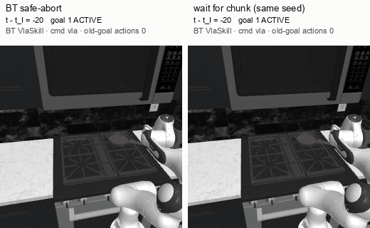
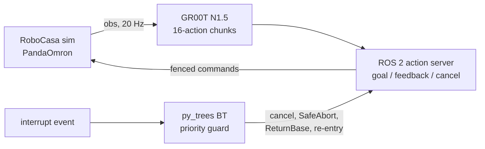
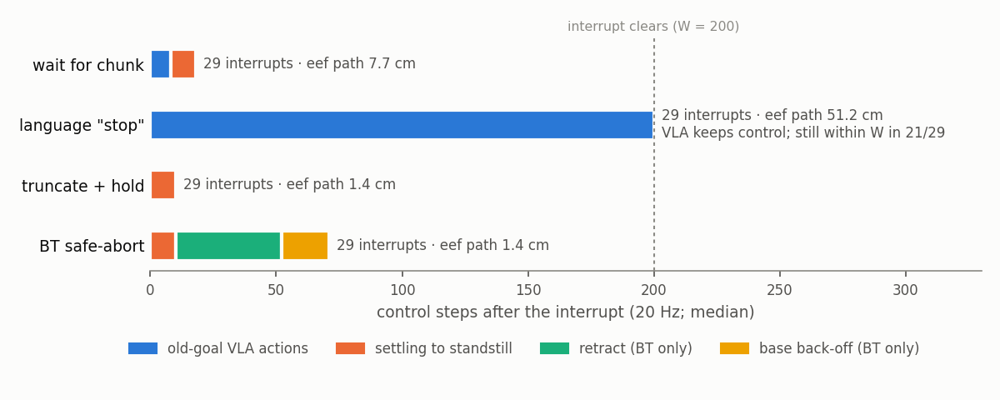

# Preemptible VLA skill for Behavior Trees: ROS 2 cancel and phase-aware safe-abort (GR00T N1.5, RoboCasa)

I built a minimal preemptible VLA skill for Behavior Trees: input a GR00T N1.5 pick-and-place skill running in RoboCasa plus an interrupt at approach, grasp or transport → output a BT-supervised stop — the ROS 2 action is cancelled mid-chunk, a phase-aware safe-abort (arm halt → retract → base back-off) runs, and the skill re-enters and finishes.
The same action server offers three other stop modes (let the chunk finish, truncate and hold, language "stop"), run on the same paired seeds as the BT safe-abort.

> Application material for *Structured Supervision of Vision-Language-Action Policies via Behavior Trees* (Mobile Robotics Lab, ETH Zurich; host M. Iovino), SiROP listing, scoped to work packages 2 and 4 as a semester project. Frozen snapshot, 2026-10-09 (v0.1.0-application).



*Evaluation seed 1, interrupt 20 steps into transport, 6 steps into a 16-action chunk (picked by the pre-registered rule: lowest seed whose transport BT episode meets all three criteria). Left, BT safe-abort: the goal is CANCELED on the interrupt step with no further old-goal action, the arm halts, retracts holding the object, the base backs off, and after the interrupt clears the base returns and a new goal places the object. Right, the same seed with the chunk allowed to finish: 10 more old-goal actions before it stops. The hold while the interrupt is active plays 4× faster (marked ×4); overlays come from the event logs.*

**Results.** BT safe-abort met all three pre-registered criteria in **23/29** interrupts (approach 9/10, grasp 8/10, transport 6/9; Wilson 95% CI 0.62–0.90) on 10 paired evaluation seeds (16 screened; 11 succeeded uninterrupted, one of them without a detected transport phase, so not paired), one configuration, with no old-goal action after the command fence and no ownership overlap in any of the 156 finished episodes (lockstep simulation). Criterion 1 (command fence within 1 control step of the cancel, no old-goal action after it) held in 29/29; the six misses are two aborts whose retract did not settle within the budget and four re-entries that did not complete. Old-goal VLA actions executed after the interrupt: wait-chunk median 8 (max 16), language "stop" median 200 of 200 window steps (min 53; "stop" is not one of this checkpoint's task instructions, so this is a probe, not a dual-system baseline), truncate-and-hold 0, BT 0. Task completed after re-entry: BT 23/29, truncate-and-hold 21/29 (same truncation, no retract or back-off; 7 vs 5 discordant pairs, a difference within noise), wait-chunk 25/29, language "stop" 17/29; uninterrupted replicates 14/20. Not shown: any BT-specific advantage over a scripted supervisor with the same fence and recovery code (not run), and anything on long-horizon tasks, navigation or composability. Every attempt is listed in [`results/results.json`](results/results.json). Fresh-instance reproduction: the one command below ran on a fresh g5.xlarge from this snapshot's code, exit 0 in 25 minutes ([`results/c9/`](results/c9/)).

**What is hard-coded:** simulation only (RoboCasa365 v1.0.1, PandaOmron); one atomic task (PickPlaceCounterToStove) with seeded kitchens; task phase from privileged simulator state (distance threshold, `check_obj_grasped` + lift); the interrupt is a topic event at a fixed offset after phase entry; scripted retract target, back-off and return-to-pre-abort base motion; the re-entry precondition only checks that the abort did not fail, and the postcondition is the simulator's success flag; BT and simulator in lockstep (latencies in control steps).

**Stack**
- **VLA:** GR00T N1.5, RoboCasa365 `atomic_seen` checkpoint (60k), weights unchanged; zmq policy server on an AWS g5.xlarge (A10G)
- **Action server and BT:** ROS 2 Humble, rclpy ActionServer (goal / feedback / cancel); py_trees 2.5.0 with an rclpy action client
- **Simulation:** RoboCasa365 v1.0.1 · robosuite 1.5.2 · MuJoCo 3.3.1 · PandaOmron mobile manipulator, 20 Hz, 12-D action (versions and upstream commits per scoring boot in [`results/env/`](results/env/))
- **Evaluation:** pre-registration and code manifest frozen before scoring ([`eval/`](eval/)); results rebuilt from per-step event logs ([`scripts/build_results.py`](scripts/build_results.py))

## Project fit at a glance

| Listing goal | What this repository does | Status |
|---|---|---|
| WP1 Review BT formalism, ROS 2 actions, VLA/BT gap | No literature review in this repository | not done |
| WP2 Wrap a VLA behind a ROS 2 action server with goal/feedback/cancel | GR00T N1.5 skill as a ROS 2 action; goal accept and feedback logged in every scored episode, cancel accept in every interrupted one (floor item `semantics`) | done in simulation |
| WP3 BT skill nodes with pre/postconditions, fallback/retry subtrees | One VLA skill node; before re-entry the precondition only checks that the abort did not fail (no state check), the postcondition is the simulator's success flag; a single re-entry, no retry subtrees, no skill library | partial |
| WP4 Preemption handling with a safe-abort recovery behaviour | Priority guard → phase-aware halt, retract, back-off; criteria 1–3 met in 23/29 interrupts | done in simulation |
| WP5 Evaluate against a monolithic long-horizon VLA baseline (success, recovery, preemption latency) | Preemption latency and recovery on one atomic task against three other stop modes of the same model; no long-horizon task, no navigation, no monolithic baseline | partial |
| WP6 (optional) Real robot (mobile FR3 Duo, Stretch 3) | — | not done |
| Composability: cost of adding or swapping a skill | — | not done |
| Heterogeneity: a classical navigation skill in the same tree as VLA skills | — (back-off and return are scripted base velocity commands, not a navigation skill) | not done |

## Pipeline at a glance



Key parameters (frozen in [`config/protocol.json`](config/protocol.json)): interrupt k = 40 / 10 / 20 steps after approach / grasp / transport entry; window W = 200 steps; abort budget T = 184 steps; back-off x = 0.20 m; contact limit F = 50 N (3-step mean); re-entry budget B = 750 steps.

## Stop-mode comparison



Shared outcomes over the same window (interrupt to clearance, 200 steps) for all four modes; 29 non-void interrupts each, pooled over the three phases ([`results/results.json`](results/results.json) → `summary.by_mode_phase`):

| | wait for chunk | language "stop" | truncate + hold | BT safe-abort |
|---|---|---|---|---|
| Old-goal VLA actions after the interrupt, median (max) | 8 (16) | 200 (200) | 0 (0) | 0 (0) |
| End-effector path after the interrupt, median | 7.7 cm | 51.2 cm | 1.4 cm | 1.4 cm |
| At standstill within the window | 29/29 | 21/29 | 29/29 | 29/29 |
| Moved again > 2 cm after resting | 0/29 | 17/21 | 0/29 | 2/29 |
| Contact over 50 N in the window | 2/29 | 5/29 | 0/29 | 0/29 |
| Object secured at the interrupt still held at clearance | 8/9 | 4/9 | 8/9 | 7/9 |
| Task completed after re-entry | 25/29 | 17/29 | 21/29 | 23/29 |
| Contact over 50 N after clearance (VLA re-entry; not a criterion) | 6/29 | 9/29 | 12/29 | 5/27 |

Uninterrupted replicates of the paired seeds completed 14/20; counting only replicates that stayed in the phase past the interrupt point (the comparator for an interrupted run), 14/20 for approach, 14/20 for grasp and 13/14 for transport, against BT 6/9 in transport. Contact after clearance comes from the VLA's own re-entry motion (the GIF episode peaks at 118 N while placing); the return-to-pre-abort motion itself had none, and the two blocked BT episodes never reached clearance. Truncate-and-hold and BT share the truncation path, so their equal action counts and paths are by design; retract and back-off are the BT's own. Language "stop" keeps the VLA in control ("stop" is not one of the checkpoint's post-training task instructions, so this probes this checkpoint only); in 2 of 29 interrupts it finished the task inside the window. On completion, BT vs truncate-and-hold disagree on 12 of the 29 (seed, phase) pairs: 7 only BT completed, 5 only truncate-and-hold did.

## Evidence snapshot

| Finding | Source |
|---|---|
| Criteria 1–3, per phase and mode, with Wilson CIs; every attempt incl. one killed by a boot stop | [`results/results.json`](results/results.json) |
| Showcase floor passes under one protocol hash and one code manifest | `results/results.json` → `summary.floor`; [`scripts/check_floor.py`](scripts/check_floor.py) |
| Protocol, void rule, block rule, predictions and GIF rule fixed before scoring: frozen 16:42:43 UTC, scoring boot recorded at 16:43:05 UTC (local commit cf078f8; history not published) | [`eval/prereg.json`](eval/prereg.json) → `frozen_utc`; `results/results.json` → `meta.boots` |
| Exact pairing: the four stop modes reached the same simulator state at the interrupt in all 29 non-void (seed, phase) groups; the pre-registration's determinism statement was wrong and is corrected | `results/results.json` → `summary.pairing_exact`; [`eval/errata.md`](eval/errata.md) |
| Pre-registered predictions P1–P3: none fully met (details below) | `results/results.json` → `summary.predictions` |
| One (seed, phase) void: seed 12 transport, the policy had left the phase before the interrupt | `results/results.json` → `summary.void` |
| Both abort failures stopped at the retract stage (did not settle within T = 184): seed 2 grasp, and seed 13 transport, which also dropped the object | `results/results.json` → `episodes` |
| Fence, cancel and recovery semantics on edge cases (cancel before accept, late inference, duplicate cancel, early clearance, failed recovery) | [`tests/`](tests/) |
| Return-to-pre-abort motion stops 6.1 cm short of the pre-abort pose with no contact over 50 N in all 27 BT episodes that reached it | `results/results.json` → `summary.return_base` |
| Package versions and upstream commits used for scoring; the install scripts are pinned to them | [`results/env/`](results/env/) |
| The published execution code differs from the scored code (manifest in `eval/frozen_manifest.json`) in 13 files, 7 of them in comments only; the other 6 add input validation and the ReturnBase past-the-pose failure, with no change on any scored episode. `scripts/remote/c6_score.sh` therefore refuses to score on this tree | [`eval/frozen_manifest.json`](eval/frozen_manifest.json), [`scripts/frozen.py`](scripts/frozen.py) |

Pre-registered predictions, evaluated literally: **P1** not met (old-goal actions and the wait-chunk count `16 − offset` as predicted, but truncate and BT moved 1.3–1.5 cm median, above the predicted 1 cm). **P2** not met (language "stop" failed to stand still within the window in 8/29, predicted ≥ 50%). **P3** not met (grasp was not the weakest phase for criterion 2; BT completed more often than truncate-and-hold in approach and grasp, against the predicted direction).

## What this is not

- Not evidence that a Behavior Tree is better than another supervisor: the comparison is between stop modes of one action server; a scripted supervisor with the same fence and recovery code was not run.
- Not a long-horizon, navigation or composability study, and not a comparison with a monolithic VLA baseline.
- Not a statement about GR00T internals; language "stop" is a probe of this checkpoint only.
- Not tested on a real robot; phase and interrupt come from simulator state.

## Quick start

Local tests (pure Python stub of the simulator and policy; no GPU, ROS or RoboCasa):

```bash
python3.12 -m venv .venv && .venv/bin/pip install -r requirements-local.txt && .venv/bin/python -m pytest -q
```

Anchor chain end to end, one command on a fresh AWS g5.xlarge (Deep Learning Base GPU AMI, Ubuntu 22.04) after cloning: installs RoboCasa, assets, GR00T N1.5 with the checkpoint and ROS 2 Humble, then runs one interrupted episode (dev seed 1003, transport, BT safe-abort) and writes the event log, results line and frames to `runs/anchor/`. Measured on a fresh instance with this snapshot's code: exit 0 after 25 minutes, most of them installing. Exit 0 means the chain ran without error; the episode's own outcome is in the results line (there: criteria 1–2 met, re-entry not completed, identical on three separate instances; an earlier pass on this seed predates the return-to-pre-abort fix).

```bash
bash scripts/remote/anchor_chain.sh
```

Rebuild every number and figure from a scoring directory (the event logs and frames are not in this repository): `python scripts/build_results.py <c6_score dir> --out results/results.json`, then `scripts/make_figures.py` and `scripts/make_gif.py`.

## How it works

- **One command owner per step.** An arbiter accepts commands only from the current owner; a cancel bumps the goal generation, so a chunk computed for the old goal is dropped even if inference returns late (criterion 1 checks this from the log).
- **Four stop modes, one server.** The stop mode travels in the goal; cancel truncates (truncate + hold, BT), lets the chunk finish (wait for chunk), or swaps the instruction to "stop" and keeps querying (language).
- **Phase-aware safe-abort.** Approach: halt, retract, back off. Grasp (contact, not secured): open, lift 5 cm, retract, back off. Transport (secured): keep closed, lift 3 cm, retract, back off. Recovery is latched: an early clearance cannot skip it, and a failed abort blocks the task branch.
- **Re-entry.** After clearance the base returns along its pre-abort heading (speed loop on measured base speed, stopping 5 cm short; if the base is ever past the pre-abort pose the node fails and holds, which prevents a false success but does not by itself prevent the overshoot: a simulated base with a much slower velocity response (time constant about 10 control steps; the real base stops within about 2) tripped the check as soon as it passed the pose, but, already holding, coasted on to 2.5 cm past it, while the real base stopped about 6 cm short in all 35 returns), the precondition (abort not failed) is checked, and one new goal is sent from the current state, with any held object kept.
- **Lockstep.** The BT ticks once per control step, so latencies are counted in control steps; wall-clock inference time is not part of them.

## How the result was reached

| Round | What | Outcome |
|---|---|---|
| Local core | Fence, stop modes, phase detector, BT on a pure-Python stub | 164 tests at the snapshot commit ([`tests/`](tests/)) |
| Controller gate | Scripted expert on dev seeds (≥ 1000): hold, retract, back-off in all three phases | 15/15 criteria 1–2; T = 184 = 2 × the slowest abort (92 steps), set before any GR00T episode ([`results/dev/c2_gate_*.jsonl`](results/dev/)) |
| Reproduction gate | Upstream evaluation of the checkpoint on this task | 14/20 upstream loop, 7/10 through this repository's server on dev seeds ([`results/dev/c3_repro.jsonl`](results/dev/c3_repro.jsonl)); a determinism check was run but was invalid (it compared two different noise streams, see [`eval/errata.md`](eval/errata.md)), so the same-seed, same-phase-trigger pairing rule was registered |
| First GR00T end-to-end attempts | Dev seed 1001 transport: the policy never reached transport, no interrupt ([`c3_s1001_transport.jsonl`](results/dev/c3_s1001_transport.jsonl)). Seed 1002, all four modes: the object was already placed at the interrupt (void under the later rule; [`c4_s1002_transport.jsonl`](results/dev/c4_s1002_transport.jsonl)). Seed 1003 transport | seed 1003: criteria 1–3 met ([`c4_s1003_transport.jsonl`](results/dev/c4_s1003_transport.jsonl)) |
| Dev estimate | 6 dev seeds uninterrupted; BT on 2 dev seeds × 3 phases | 6/6 completed; 6/6 criteria 1–3 ([`results/dev/c5_dev_*.jsonl`](results/dev/)) |
| Pre-freeze check | Replay of the dev logs: the old return-to-pre-abort motion went 0.5–3.9 cm past the pre-abort pose in 22 of 23 episodes and hit the counter (300–365 N) on two layouts | fixed (speed loop, stop 5 cm short); re-checked on dev seeds 1002/1004/1005: 8/8 returns without contact, re-entry then completed in 6/8 ([`results/dev/returnbase_*.txt`](results/dev/), [`c5_returnbase_check.jsonl`](results/dev/c5_returnbase_check.jsonl)) |
| Freeze | Pre-registration and execution-code manifest committed before any evaluation-seed episode | [`eval/`](eval/) |
| Block 1 | Evaluation seeds 0–11, 6 paired | one episode killed by a boot stop, re-run on the next boot |
| Block 2 | Seeds 12–15, extended to 10 paired (pre-registered rule) | floor met; no extension to 15 |
| Fresh-instance acceptance | The README's one command on a fresh g5.xlarge from the committed tree | first run: install complete, then a shell-option bug stopped the script before the servers started (fixed); second run on another fresh instance: exit 0 in 28 minutes; after the last input-validation fixes, a third fresh instance ran this snapshot's code: exit 0 in 25 minutes, the same episode each time ([`results/c9/`](results/c9/)) |
| Post-scoring review | Two independent execution-level reviews (boundary and malformed inputs), one of the scoring code and one of the near-final code (before the last input-validation fixes); the second recomputed every number from the raw event logs with its own code and matched all of them | no finding changes a scored episode; fixed after scoring: input validation in the runner, scoring wrapper, metrics and results builder (malformed logs are rejected), stricter manifest check, ReturnBase fails instead of succeeding if the base ever passes the pre-abort pose; rebuilt results and figures unchanged |

## Limitations and next steps

- Recovery failures: two retracts did not settle within the abort budget (seed 2 grasp; seed 13 transport, which also dropped the object). Both, and the slowest successful retract (finished 144 steps after the interrupt), are in kitchen layout 9; the cause is not diagnosed yet. On seed 14 transport the secured object was lost under BT, wait-chunk and truncate-and-hold alike; a grasp-aware hold and a retract that tracks the object would be the next fixes.
- The "for free" question is open: BT and truncate-and-hold completion did not differ beyond noise here (23/29 vs 21/29; 7 vs 5 discordant pairs), but the claim that a BT earns its place needs the scripted-supervisor ablation and a long-horizon task with a classical navigation skill in the same tree, which is the thesis-scale next step.
- Ten paired seeds on one task: intervals are wide (e.g. 0.62–0.90 for criteria 1–3). Phase detection from simulator state missed one transport phase (seed 4).

## Repo layout

| Path | Contents |
|---|---|
| `preempt/` | Contracts, command arbiter and fence, stop modes, phase detector, recovery motions, metrics |
| `bt/` | py_trees tree: interrupt guard, SafeAbort, ReturnBase, re-entry |
| `ros/` | ROS 2 action interface, skill host, BT runner |
| `sim/`, `policy/` | RoboCasa server, GR00T client and seeded policy server |
| `scripts/` | Episode runner, scoring wrapper, floor check, results builder, figures |
| `config/` | Frozen protocol parameters |
| `eval/` | Pre-registration, frozen code manifest, errata |
| `results/` | Rebuilt results; `dev/` development-round results; `env/` package versions per scoring boot |
| `figures/` | Demo GIF and stop-ladder figure |
| `docs/` | Integration notes |
| `tests/` | Stub-based tests |

## Data, licences and references

This repository's code is released under the [MIT licence](LICENSE). No simulator assets, model weights or third-party source are included; the scripts in `scripts/remote/` fetch them from upstream. Event logs and raw frames are not included; `figures/demo.gif` shows rendered RoboCasa scenes (RoboCasa assets, [CC BY 4.0](https://creativecommons.org/licenses/by/4.0/), downscaled with overlays).
- **Simulation:** [RoboCasa365](https://github.com/robocasa/robocasa) v1.0.1 (code MIT; assets and datasets CC BY 4.0) on [robosuite](https://github.com/ARISE-Initiative/robosuite) 1.5.2 (MIT) and [MuJoCo](https://github.com/google-deepmind/mujoco) 3.3.1 (Apache-2.0).
- **Policy:** GR00T N1.5 code from the [RoboCasa fork](https://github.com/robocasa-benchmark/Isaac-GR00T) of [NVIDIA Isaac-GR00T](https://github.com/NVIDIA/Isaac-GR00T) (Apache-2.0). Checkpoint [`robocasa/robocasa365_checkpoints`](https://huggingface.co/robocasa/robocasa365_checkpoints) (`atomic_seen`, 60k; tagged Apache-2.0), post-trained by the RoboCasa authors from the public GR00T N1.5 base model [`nvidia/GR00T-N1.5-3B`](https://huggingface.co/nvidia/GR00T-N1.5-3B), whose [NVIDIA License](https://huggingface.co/nvidia/GR00T-N1.5-3B/blob/main/LICENSE) limits the model and its derivatives to non-commercial research or evaluation use. Here the weights are used unchanged, for research only.
- **BT and middleware:** [py_trees](https://github.com/splintered-reality/py_trees) 2.5.0 (BSD-3-Clause), [ROS 2 Humble](https://docs.ros.org/en/humble/) (rclpy, action_msgs: Apache-2.0).
- **References:** RoboCasa365 (Nasiriany et al., ICLR 2026, [arXiv:2603.04356](https://arxiv.org/abs/2603.04356)); RoboCasa (Nasiriany et al., RSS 2024, [arXiv:2406.02523](https://arxiv.org/abs/2406.02523)); robosuite (Zhu et al., [arXiv:2009.12293](https://arxiv.org/abs/2009.12293)); GR00T N1 (NVIDIA, Bjorck et al., [arXiv:2503.14734](https://arxiv.org/abs/2503.14734)); MuJoCo (Todorov et al., IROS 2012, [doi:10.1109/IROS.2012.6386109](https://doi.org/10.1109/IROS.2012.6386109)); ROS 2 (Macenski et al., Science Robotics 2022, [doi:10.1126/scirobotics.abm6074](https://doi.org/10.1126/scirobotics.abm6074)); M. Colledanchise and P. Ögren, *Behavior Trees in Robotics and AI: An Introduction*, CRC Press 2018 ([arXiv:1709.00084](https://arxiv.org/abs/1709.00084)).
